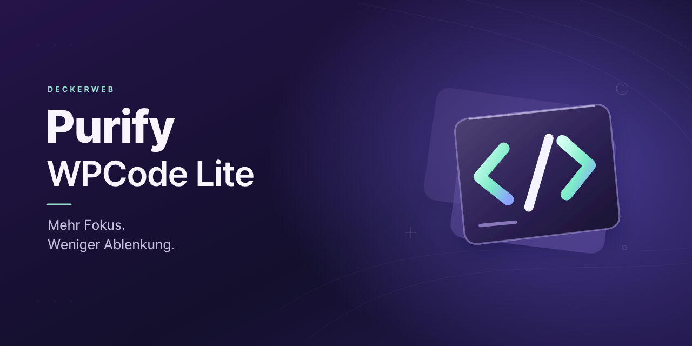

# Purify WPCode Lite

[English](README.md) · [Dokumentation](docs/FAQ.de.md) · [Documentation](docs/FAQ.en.md)

Purify entfernt bekannte Werbung aus WPCode Lite und erhält den Zugriff auf nützliche Free-Funktionen.

Version **1.1.1** · WordPress **6.7+** · PHP **8.1+** · GPL v2 or later

[Installation](#installation) · [Voraussetzungen und Grenzen](#voraussetzungen-und-grenzen) · [FAQ](#häufige-fragen) · [Änderungsverlauf](#änderungsverlauf)

## Auf einen Blick

- Bereinigung für WPCode Lite 2.3.9 und 2.4.0.
- Erhält Free-Library, Fehler-Logging und Shortcode-Attribute.
- Nützliche Snippet-Toolbar-Links und kleine Verbesserungen am Editor.
- Gemeinsamer deckerweb-Katalog, GitHub-Release-Updates und lokaler Änderungsverlauf.

## Installation

1. ZIP unter Plugins → Installieren → Plugin hochladen installieren.
2. WPCode Lite und Purify aktivieren. Keine zweite Purify-Snippet-Version parallel verwenden.
3. Status unter Plugins prüfen; bei unterstütztem WPCode arbeitet die Bereinigung automatisch.

## Gezielte Bereinigung

Benannte PHP-Hooks und Seitenadapter unterbinden Werbung bevorzugt vor der Ausgabe. Gezieltes CSS und DOM-Behandlung decken verbleibende Promo-Bereiche und dynamische Upgrade-Dialoge ab. Fehlerhinweise, Free-Library, Generatoren, Import/Export, Logging und Standard-Shortcodes bleiben erhalten. Library- und Updater-Daten werden nach ihren eigenen dokumentierten Regeln verwaltet.

## Voraussetzungen und Grenzen

WordPress 6.7 und PHP 8.1 oder neuer sind erforderlich. Enthalten sind Library 1.1.0 und Updater 2.2.1. Die Bereinigung gilt weiterhin für WPCode Lite 2.3.9 und 2.4.0; bei ungeprüften Versionen pausiert sie. Versteckte Premium-Menüs können weiterhin direkt erreichbar sein. ClassicPress und vollständige produktive Updatezustellung sind nicht bestätigt.

## Häufige Fragen

### Werden Pro-Funktionen freigeschaltet?

Nein. Nicht verfügbare Pro-Optionen behalten sachliche Kennzeichnungen und neutrale Dialoge.

### Welche WPCode-Versionen werden unterstützt?

Die Bereinigung richtet sich an Lite 2.3.9 und 2.4.0. Bei einer anderen Version, fehlendem WPCode oder aktivem WPCode Pro pausiert sie; die Plugins-Seite erklärt den Status.

### Wo kann ich es konfigurieren?

Die Bereinigung arbeitet automatisch. Der gemeinsame Katalog hat seine vorhandene Einbindung unter Plugins; Purify erzeugt keine eigene Einstellungsseite nur für Branding.

### Werden Fehlerhinweise oder Tracking deaktiviert?

Nein. Fehler-, Sicherheits- und Speicherhinweise bleiben erhalten. Deine Tracking-Auswahl bleibt unverändert. Die Remote-News-/Marketing-Inbox wird deaktiviert; sie kann auch Produktneuigkeiten enthalten.

### Wird Multisite unterstützt?

Die Bereinigung nutzt den jeweiligen Website- und Nutzerkontext und lässt sich netzwerkweit aktivieren. Gemeinsame Library-Einstellungen gelten für das Netzwerk. Zusätzliche Multisite-Snippet-Funktionen werden nicht ergänzt; beachte die dokumentierten Testgrenzen.

### Was passiert bei der Entfernung mit meinen Daten?

Purify speichert keine Snippet-Inhalte oder Cleanup-Einstellungen. Die Deaktivierung erhält Daten. Bei Deinstallation bleiben andere installierte Library-Hosts und ihre gemeinsamen Daten erhalten. Nur der letzte Host bereinigt temporäre Library-Caches und Aufgaben; Einstellungen bleiben erhalten, sofern ihre gesonderte Löschoption nicht eingeschaltet wurde. Installierte Plugins und WPCode-Daten bleiben erhalten.

### Welche externen Verbindungen gibt es?

Der Updater prüft dieses öffentliche GitHub-Repository über WordPress-Updateprüfungen. Die Library enthält einen lokalen Katalog; optionaler Onlineabgleich ist anfangs aus und kontaktiert nach Aktivierung den freigegebenen GitHub-Katalog. Bewusst ausgelöste Installationen laden freigegebene Pakete. Purify ergänzt keine Telemetrie.

[Vollständige Fragen nach Themen](docs/FAQ.de.md)

## Änderungsverlauf

### 1.1.1 · 2026-10-22

- **Verbessert:** Plugin-Katalog und GitHub-Updateversorgung aktualisiert.
- **Behoben:** Der lokale Änderungsverlauf bleibt bis zum Öffnen verborgen und behält einen Dokumentationslink als Fallback.
- **Sonstiges:** Benötigt PHP 8.1 oder neuer; WordPress 6.7 bleibt unterstützt.

### 1.1.0 · 2026-10-09

- **Neu:** Gemeinsamer Plugin-Katalog, GitHub-Release-Updates und lokaler Änderungsverlauf.
- **Verbessert:** Die Bereinigung unterstützt WPCode Lite 2.4.0 und erhält nützliche Free-Funktionen.
- **Behoben:** Bei ungeprüften WPCode-Versionen pausiert die Bereinigung sicher.
- **Behoben:** Deutsche Dialogübersetzungen werden über die Plugin-Textdomain geladen.
- **Behoben:** Bei fehlendem oder inaktivem WPCode Lite bleibt die Aktivierung im WordPress-Admin; die Bereinigung pausiert.
- **Sonstiges:** Newsletter-Links enthalten keine persönlichen Kontodaten.
- **Sonstiges:** Lokale Grafiken aktualisiert.

### 1.0.0 · 2025-04-04

- **Neu:** Erste öffentliche Veröffentlichung.

## Autor und Projekt

David Decker – DECKERWEB. Purify konzentriert sich auf eine nutzbare Free-Oberfläche. Veröffentlichungsweg ist GitHub; dieses Plugin wird nicht über WordPress.org angeboten.

## Issues and security

[Issues](https://github.com/deckerweb/purify-wpcode-lite/issues) · [Security](SECURITY.md)

Sicherheitsdetails nicht öffentlich posten. Der vertrauliche Meldeweg und sein aktueller Status stehen in SECURITY.md.

## Support

[Ko-fi](https://ko-fi.com/deckerweb) · [Buy Me a Coffee](https://buymeacoffee.com/daveshine) · [PayPal](https://paypal.me/deckerweb) · [Newsletter](https://eepurl.com/gbAUUn)

Copyright © 2025–2026 David Decker – DECKERWEB. GPL-2.0-or-later.

Herkunft und Lizenzen: [Drittanbieter](THIRD-PARTY.md).
